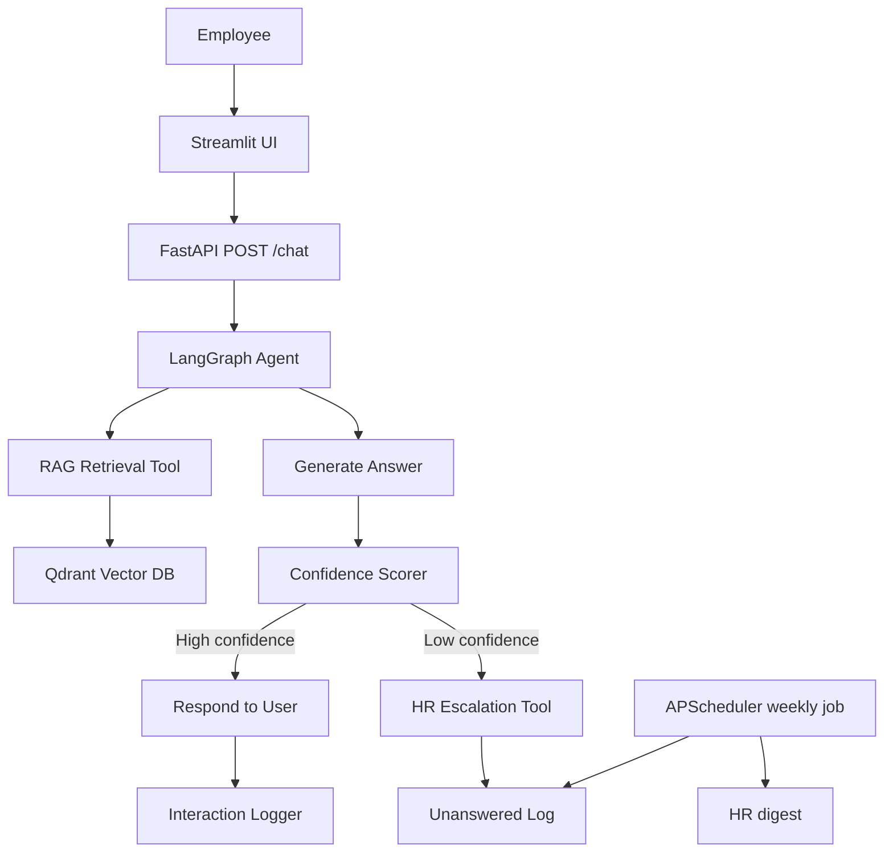
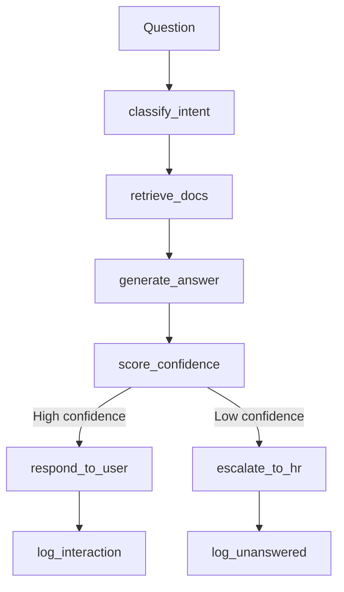

# HR Onboarding Agent

HR onboarding assistant for NordTech Solutions, a distributed company with offices in Tallinn, Porto, and Tampere. It helps employees find clear answers from internal policy documents, reduces repetitive HR support, and escalates uncertain or out-of-scope questions to HR.

## Architecture

Single LangGraph agent, multiple tools.

## Data Flow

## Documents

The knowledge base lives in `docs/` and includes:

- Employee Handbook
- Onboarding Checklist
- IT Setup Guide
- Leave & Absence Policy
- Benefits & Perks Guide
- Expense & Reimbursement Policy
- Org Chart & Team Directory
- GDPR Employee Data Policy
- EU AI Act Compliance Summary
- HR FAQ Log

## About NordTech Solutions

NordTech Solutions is the fictional company behind this knowledge base. It operates across three offices in Tallinn, Porto, and Tampere, with policies shaped for a distributed team. The content in this repository covers the employee questions that typically come up during onboarding and day-to-day work: how to set up devices, where to request leave, what benefits are available, who to contact, and how internal policies work.

## What It Is For

This system is designed to give employees a fast, grounded way to get HR answers without forcing them to search across multiple documents or wait for manual replies. It is meant to answer routine policy questions directly, cite the right internal sources, and route edge cases to HR when the documents are incomplete or the confidence score is low.

## Tech Stack

- LangGraph for orchestration
- LangChain for document and retrieval primitives
- Qdrant for vector search
- FastAPI for the API
- Streamlit for the UI
- APScheduler for weekly digests
- SQLite and SQLAlchemy for interaction logging
