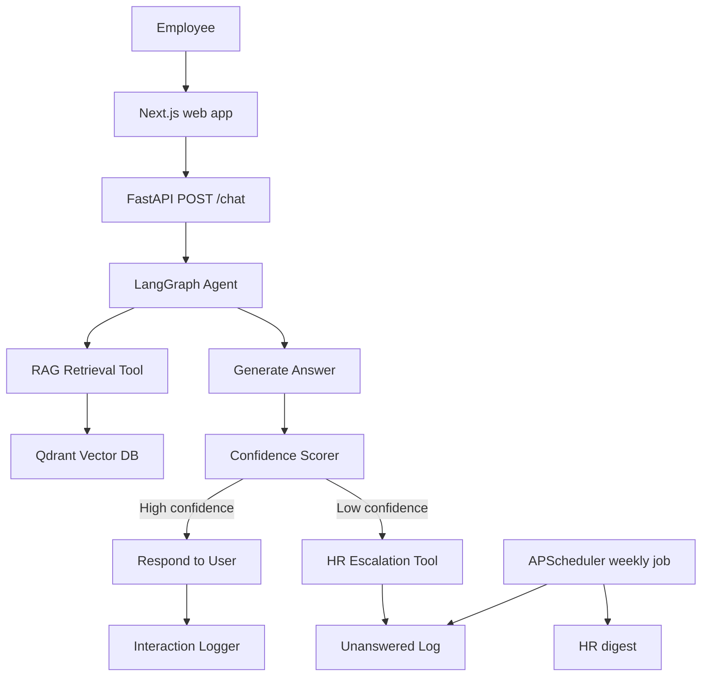
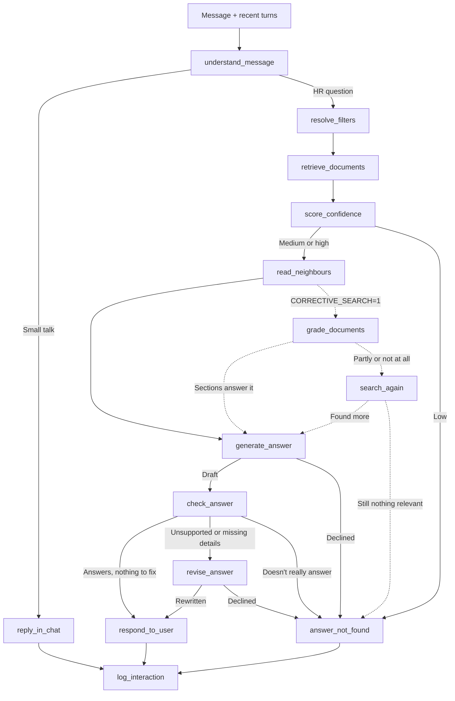

# HR Onboarding Agent

[](https://www.python.org/)
[](https://langchain-ai.github.io/langgraph/)
[](https://fastapi.tiangolo.com/)
[](https://nextjs.org/)
[](https://qdrant.tech/)
[](https://python-poetry.org/)

HR onboarding assistant for NordTech Solutions, a fictional 200-person company with offices in Tallinn, Porto, and Tampere. It is scoped to HR onboarding and policy lookup: the agent answers common employee questions from the internal corpus, reduces repetitive HR support, and escalates uncertain or out-of-scope questions to HR.

## Architecture

Single LangGraph agent, multiple tools.

The system is built as one agent with five tools:

- RAG retrieval
- confidence scoring
- HR escalation
- interaction logging
- a weekly digest job

This keeps the system bounded and easy to reason about while still covering the full workflow from question to answer or handoff.

## What This Project Is

This is a single LangGraph agent for HR onboarding and internal policy support. It answers employee questions from a fixed knowledge base, uses retrieval to stay grounded, and escalates when the system is not confident enough to answer safely.

The goal is a production-style assistant that can handle the repetitive HR questions employees ask during onboarding and day-to-day work, while preserving a human handoff for edge cases.

## Company Context

NordTech Solutions is the fictional company behind the project. It is a ~200-person tech startup with offices in Tallinn, Porto, and Tampere.

That setup is deliberate. It gives the project a realistic but bounded domain, and the three-office, EU-based structure makes the HR content naturally include leave rules, benefits, compliance, and contact routing across multiple countries.

The documents in this repo are written for that context and are meant to feel like real internal policy material, not generic demo text.

## The Five Tools

The agent is built around five tools:

1. `RAG Retrieval Tool`
   - Takes the employee's question and retrieves the most relevant chunks from the HR knowledge base.
   - The knowledge base includes the handbook, leave policy, IT setup docs, benefits material, onboarding docs, and related policy references.
   - Uses hybrid search so it can combine keyword matching and semantic retrieval instead of relying on only one method.
   - Passes the top candidates through a reranking step before the answer is generated, so the model sees the strongest evidence first.
   - Returns the retrieved chunks with source attribution and relevance scores.

2. `Confidence Scorer`
   - Scores how confident the system should be that the retrieved context is enough to answer the question safely.
   - Exists because an HR assistant that confidently guesses wrong is worse than one that escalates.
   - Uses retrieval quality and groundedness signals to decide whether the answer should be returned or handed off.
   - Produces a confidence value that drives the agent's branching logic.
   - Low confidence triggers escalation instead of a speculative response.

3. `HR Escalation Tool`
   - Activates when confidence is too low or the question needs human judgment.
   - Routes the query to a human HR contact rather than letting the model invent an answer.
   - Handles sensitive or edge-case questions such as grievances, legal ambiguity, or anything outside the policy set.
   - Formats the question and context into a structured handoff so HR can review it quickly.
   - Asks the employee first, and only sends questions they agree to; those wait in the HR inbox and reach HR in one email at the end of the day, with who asked. HR's answer goes back to the employee's chat and into the knowledge base.
   - This is the system's safety valve and the main human-in-the-loop path.

4. `Interaction Logger`
   - Logs every interaction for traceability, debugging, and later analysis.
   - Records the question, retrieved context, confidence score, whether the query escalated, and the final answer.
   - Provides an audit trail for evaluating how the system behaves over time.
   - Supports later analysis of common question patterns and unanswered topics.
   - Feeds the weekly digest workflow.

5. `Weekly Digest Job`
   - Runs independently on a schedule rather than inside the chat loop.
   - Summarizes the week's unanswered or low-confidence questions.
   - Groups recurring topics and flags documentation gaps for HR.
   - Gives the system a background automation layer, not just a request/response chat flow.
   - Demonstrates that the assistant can support ongoing knowledge maintenance, not only live answers.

This setup keeps the agent simple: one brain, a few clearly separated responsibilities, and a safe fallback path when the answer is uncertain.



## Data Flow



- `understand_message` sorts greetings, thanks and other small talk from HR questions, and rewrites follow-ups ("and in Finland?") into standalone questions using the last few turns of the chat.
- `resolve_filters` searches the employee's own country, unless the question names another one.
- Searches add the policies' own words for everyday ones ("vacation" also searches "annual leave"), see `retrieval/vocabulary.py`.
- `read_neighbours`: documents are split into ~500-character pieces, and the condition that matters (an approver, the day a rule changes) is often in the next piece of the same section. Each found piece is read with the pieces either side of it, joined into one passage without the repeated overlap (`retrieval/context.py`). Citations still open the piece search found.
- `grade_documents` and `search_again` are corrective RAG, off unless `CORRECTIVE_SEARCH=1`. `gpt-4.1-mini` grades whether the passages answer the whole question; if not, one more search runs for what's missing, in the policies' own words, and adds the passages that help. If neither search finds anything relevant, the employee is offered HR without an answer being written. Grading never removes passages: dropping the ones graded unhelpful cost more answers than it saved. It's off by default because, on the evaluation set, it added about a second per answer without changing the results: the first search already finds the right document for every test question, and reading neighbours brings in what was missing. It's there for real employees' phrasing, which is harder than the FAQ log's.
- `check_answer` reviews each draft before the employee sees it (the critique step of Self-RAG, with `gpt-4.1`): a draft that talks around the question ("not covered", "case by case") becomes an offer to ask HR, and one with unsupported claims or a missing condition is rewritten once by `revise_answer`. Because of this, answers aren't streamed while they're written; the progress steps show the check instead.
- `respond_to_user` turns the answer's citations into numbered sources. The answer model marks each sentence or list item with the passage it came from; these are renumbered in the order the answer first uses them, and a source keeps its number every time it's cited, so the employee sees [1], [2], ... for exactly the sources used, however many there are (`agent/citations.py`). Earlier answers are given to the models without their numbers, since those point to another search's passages.
- `answer_not_found` asks the employee whether to send the question to HR; nothing is sent until they say yes.

## Results

Measured with `scripts/eval_answers.py` on 95 turns: the 76 questions in HR's FAQ log and 19 turns of multi-turn conversations. Of those, 75 can be answered from the documents, 13 should go to HR, and 7 are small talk; `gpt-4.1` grades correctness and grounding. Each row adds one upgrade to the one above.

| Upgrade | Turns fully passing | Correct answers | Sent to HR when they should be | Fully grounded answers | Median time |
|---|---|---|---|---|---|
| First version | 75/95 | 67/75 | 10/13 | 66/77 | 2.5 s |
| Prompt fixes | 84/95 | 70/75 | 8/13 | 78/80 | 2.2 s |
| Self-check | 88/95 | 72/75 | 11/13 | 74/77 | 3.5 s |
| Reading neighbouring sections | **90/95** | **73/75** | **11/13** | 75/77 | 3.7 s |
| Numbered citations | **90/95** | 72/75 | **11/13** | **77/77** | 4.0 s |

- **Prompt fixes**: steps only from the documents, every condition kept, and a country named in the question honoured.
- **Self-check**: `gpt-4.1` reviews each draft before the employee sees it (the critique step of Self-RAG). Drafts that talk around the question go to HR, and ones with an unsupported claim or a missing condition are rewritten. Questions that should go to HR got there 11 times out of 13, up from 8.
- **Reading neighbouring sections** (corrective RAG): each section search finds is read with the sections either side of it, which brought in the details search alone missed, such as Finance's approval over €300 and Kela paying sick leave from day 10.
- **Numbered citations**: every answer marks where each fact comes from, and every answer was fully grounded.

Search finds the right document first for 91% of the 65 answerable FAQ questions, and in the top five for all of them (hit@1 0.908, hit@5 1.000, MRR 0.949), with BM25 and BGE combined by reciprocal rank fusion.

## Corpus

The knowledge base lives in `corpus/` and includes:

- Employee Handbook
- Onboarding Checklist
- IT Setup Guide
- Leave & Absence Policy
- Working Hours & Payroll Policy
- Benefits & Perks Guide
- Expense & Reimbursement Policy
- Org Chart & Team Directory
- GDPR Employee Data Policy
- EU AI Act Compliance Summary

`corpus/hr_faq_log.csv` is the HR FAQ Log. It is not ingested: it is kept as a held-out evaluation set of employee questions with expected answers and source documents, including questions the corpus deliberately cannot answer (`source_doc: NONE`), which the agent should escalate.

Project documentation lives in `docs/` and is reserved for architecture notes, ingestion and retrieval design, and ADRs.

## What It Is For

This system is designed to give employees a fast, grounded way to get HR answers without forcing them to search across multiple documents or wait for manual replies. It is meant to answer routine policy questions directly, cite the right internal sources, and route edge cases to HR when the documents are incomplete or the confidence score is low.

The build order is also intentional: document ingestion comes first, then retrieval, then the agent layer, then the API and UI.

## Tech Stack

- LangGraph for orchestration
- LangChain for document and retrieval primitives
- Qdrant for vector search
- FastAPI for the API
- Next.js (React, TypeScript, Tailwind CSS) for the web app
- APScheduler for weekly digests
- SQLite and SQLAlchemy for interaction logging, accounts and sign-in sessions

## Run It Locally

Create a `.env` file from `.env.example` and set at least `OPENAI_API_KEY`.

### With Docker

```bash
cp .env.example .env          # then add OPENAI_API_KEY
docker compose up --build
```

This starts everything: Qdrant, Mailpit, the API and the web app. Open http://localhost:3000 and sign in with one of the [demo accounts](#demo-accounts). On the first start the API loads the corpus into Qdrant and adds the demo accounts; after that it leaves both as they are. Chats, the HR inbox and accounts are kept in `./data`, shared with runs outside Docker, and Mailpit's inbox for the HR digest is at http://localhost:8025. The API image runs PyTorch on the CPU and includes the embedding model, so the first build takes a few minutes. Give Docker at least 4 GB of memory: loading the corpus needs more than the 2 GB some setups (Colima, for one) start with.

### Without Docker

For the API outside Docker, `.env` also needs:

```bash
QDRANT_URL=http://localhost:6333
QDRANT_COLLECTION=nordtech_hr
```

`COHERE_API_KEY` is optional. The API runs without Cohere reranking unless `USE_COHERE_RERANK=true` (the trial key is limited to 10 calls a minute). Corrective RAG (grading the found sections and searching again) is off unless `CORRECTIVE_SEARCH=true`.

**1. Start Qdrant and Mailpit, and ingest the corpus**

```bash
docker compose up -d qdrant mailpit
PYTHONPATH=. poetry run python scripts/ingest.py
```

Mailpit catches the HR digest email locally, so nothing real is sent; its inbox is at http://localhost:8025.

**2. Start the API** (port 8010)

```bash
PYTHONPATH=. poetry run uvicorn api.main:app --port 8010
```

On first start, with no accounts in the database, the API adds the [demo accounts](#demo-accounts). `scripts/seed_users.py` does the same on demand and adds any that are missing.

Every route except `GET /health` and `POST /auth/sign-in` needs a signed-in session, and answers `401` without one.

- `POST /auth/sign-in` checks `{"email": "...", "password": "..."}` and sets the session cookie; `POST /auth/sign-out` ends the session; `GET /auth/me` returns the signed-in user's profile
- `POST /chat/stream` answers a question as server-sent events: `status` updates while it searches, `token` events as the answer is written, then `done` with the full answer and sources
- `POST /chat` answers in one response: `{"message": "...", "session_id": "..."}`. Where the employee works (country, office, department, role) comes from their account, not the request
- `POST /interactions/{interaction_id}/hr-request` records whether the employee wants an unanswered question sent to HR: `{"ask_hr": true}`
- `POST /interactions/{interaction_id}/feedback` rates one of the employee's own answers: `{"rating": "up" | "down" | null, "comment": "..."}`; a comment is kept only with a thumbs down, and `null` takes the rating back
- `GET /sessions` lists the signed-in user's chats, newest first, with the number of unread HR replies in each
- `GET /sessions/{session_id}/messages` returns one of the user's chats, including HR's replies, and marks those replies as read. Other users' chats answer `404`
- `GET /sources/{chunk_id}` returns the source document of a cited chunk with the chunk's character span, so the UI can open it with that part highlighted
- `GET /health`

HR team only (`403` for employees):

- `GET /hr/overview`: open questions, questions answered this week, answers marked unhelpful that haven't been reviewed, and the most common unanswered topics of the last 30 days
- `GET /hr/questions?status=requested|answered`: questions sent to HR, with who asked
- `GET /hr/questions/{interaction_id}`: one question with why the assistant couldn't answer, the documents it checked, and the earlier turns of the chat
- `POST /hr/questions/{interaction_id}/answer`: `{"answer": "...", "applies_to": "country" | "everyone"}` sends HR's answer to the employee and adds it to the knowledge base
- `GET /hr/review?show=all|unhelpful|helpful|not_answered|reviewed&offset=0&limit=30`: every logged question for the answer review, newest first, with the total. Anonymous: only the asker's country, with their name taken out of the question and answer
- `GET /hr/review/{interaction_id}`: one question with the answer's sources, the employee's rating, HR's review and the earlier turns of the chat
- `POST /hr/review/{interaction_id}`: `{"verdict": "correct" | "corrected", "answer": "..."}` saves HR's review; `corrected` needs the answer HR would have given. Reviewing again replaces it
- `GET /hr/usage?period=day|week|month|year`: tokens and cost of the assistant's model calls for today, this week, this month and this year, the monthly limit, and that period's split by model, by agent step and by source

Every question is logged to `data/interactions.db` with the user who asked (`user_id`). Questions the documents can't answer have `answered = 0` and `escalation_status` set to `offered`, then `requested` or `declined` once the employee chooses, or `dismissed` if they ask something else without choosing; the ones sent to HR also have `escalated = 1`, and become `answered` when HR replies from the HR inbox (`hr_answer`, `hr_answered_by`, `hr_answered_at`).

Declined and dismissed questions don't store a name or email. Questions sent to HR also store who asked (`employee_name`, `employee_email`), taken from the signed-in account, so HR can reply.

**HR digest email.** Once a day at `HR_DIGEST_TIME` (default 18:00, `Europe/Tallinn`) the API emails `HR_DIGEST_TO` every question sent to HR since the last digest: the question, who asked and their email, where they work, why the assistant couldn't answer, which documents it checked, and a link to answer it in the HR inbox (`HR_INBOX_URL`). Questions HR already answered in the inbox are left out. Nothing is sent on days without new questions. Each question is marked with `hr_notified_at` once the email is accepted, so a failed send is retried next time and nothing is sent twice. SMTP settings are in `.env.example`; set `HR_DIGEST_TIME=` (empty) to turn it off. To send it now, or from cron instead:

```bash
PYTHONPATH=. poetry run python scripts/send_hr_digest.py            # send now
PYTHONPATH=. poetry run python scripts/send_hr_digest.py --dry-run  # print it, send nothing
```

**3. Start the web app** (port 3000)

```bash
cd web
npm install
npm run dev
```

Open http://localhost:3000 and sign in with one of the [demo accounts](#demo-accounts). The web app proxies `/api/*` to the API; set `HR_API_URL` if the API runs somewhere other than `http://localhost:8010`.

Answers mark their sources inline as numbers after each sentence; clicking a number opens that document beside the chat, with the part the answer used highlighted. When the documents don't cover a question, the assistant says so and asks whether to send it to HR; nothing goes to HR unless the employee says yes. HR's answer appears in that chat, and the chat is marked in the sidebar until the employee opens it. The profile page shows the employee's details as the assistant sees them.

### Demo accounts

All demo accounts share the password `nordtech-demo`. **It is for local demos only**: change or remove these accounts anywhere else. Everyone is fictional; all addresses use the `nordtech.test` domain.

| Role | Name | Email | Job title | Office | Started | Pronouns |
|---|---|---|---|---|---|---|
| HR | Marju Ilves | marju.ilves@nordtech.test | HR Business Partner | Tallinn, Estonia | Feb 2021 | she/her |
| Employee | Kertu Vaher | kertu.vaher@nordtech.test | Junior Backend Engineer | Tallinn, Estonia | 19 Oct 2026 | she/her |
| Employee | Joonas Laaksonen | joonas.laaksonen@nordtech.test | Senior Account Executive | Tampere, Finland | 26 Oct 2026 | he/him |
| Employee | Mariana Lopes | mariana.lopes@nordtech.test | Product Designer | Porto, Portugal | Mar 2025 | she/her |
| Employee | Alex Rinne | alex.rinne@nordtech.test | Site Reliability Engineer | Remote (employed in Finland) | Sep 2026 | they/them |
| Employee | Duarte Mendes | duarte.mendes@nordtech.test | Marketing Lead | Porto, Portugal | May 2023 | he/him |

Managers are the team leads from the org chart. The assistant uses each person's country for country-specific rules; remote work doesn't change it.

### HR platform

`/hr` is for the HR team only. The inbox lists the questions employees sent to HR, oldest first, with an overview of open questions, questions answered this week, and the most common unanswered topics (the closest document section, over the last 30 days). Each question shows who asked (name, email, job title, office), when, why the assistant couldn't answer, which documents it checked, and the earlier turns of the chat.

HR writes an answer and chooses who it applies to: employees in the asker's country, or everyone. Sending it:

1. adds the question and answer to the knowledge base as a new chunk (`source_doc: hr_answers`, `doc_type: faq_log`, `category: FAQ`, `country` set to that choice): it is embedded and written to Qdrant, and added to the running BM25 index, so the assistant can use it for similar questions straight away, without a restart
2. marks the question `answered`, with who answered and when
3. shows the answer in the employee's chat

The answered list keeps every question HR has answered. Answers cited by the assistant open in the source viewer like any other source.

Employees rate answers with a thumbs up or down under each one, and a thumbs down asks what was wrong. The **answer review** lists every question employees have asked the assistant, newest first, filtered by all, marked unhelpful, marked helpful, not answered, or reviewed. It doesn't say who asked: only the country whose rules applied, with the employee's name replaced by `[name]` in what was said (answers greet employees by first name). The sidebar counts answers marked unhelpful that haven't been reviewed yet. For each answer HR can mark it right, or write the answer they would have given. Reviews are kept to test and improve the assistant: the employee doesn't see them, and unlike inbox answers they aren't added to the knowledge base. The chat tells employees that HR reviews chats without names.

**Usage.** Every OpenAI call is counted with the model, the agent step that made it (understanding the message, writing the answer, checking it, ...), its input, cached and output tokens, and its cost at OpenAI's list prices (`agent/usage.py`), in the `model_calls` table. The Usage page shows what the assistant cost today, this week, this month and this year, what an employee's question takes on average, and where the money goes by model, by step, and by source: employees' questions, evaluation runs, or questions from `scripts/ask_agent.py`. Each question in the answer review shows its own tokens and cost. With `LANGFUSE_PUBLIC_KEY` and `LANGFUSE_SECRET_KEY` set, every question's run is also traced in [Langfuse](https://langfuse.com): each step's prompt, output, tokens and time, grouped by chat. Everyone's name is replaced with `[name]` and email addresses with `[email]` before anything is sent, and the employee's job, department and start date are left out; the user is their account id (`agent/tracing.py`). Set `MONTHLY_BUDGET_USD` to cap the month: once it's reached, the assistant stops answering until next month and points employees to HR by email, and the page shows how much of the limit is used.

`scripts/export_examples.py` writes every rated or reviewed answer to `data/exports/examples.jsonl` (the chat before it, the answer and its sources, the rating and comment, HR's review), and the answers HR rewrote to `data/exports/preference_pairs.jsonl` as preference pairs in OpenAI's DPO fine-tuning format, HR's answer preferred over the assistant's. Both are anonymous in the same way as the review.

```bash
PYTHONPATH=. poetry run python scripts/export_examples.py
```

### Command line

Ask the agent directly, without the API or web app:

```bash
PYTHONPATH=. poetry run python scripts/ask_agent.py "How much annual leave do I get?" --employee-country Estonia --no-rerank
```

The script prints the answer, confidence, sources, and for escalated questions the reason plus the draft answer that was withheld.

### Tests

```bash
PYTHONPATH=. poetry run pytest
```

### Evaluating answers

`scripts/eval_answers.py` runs the real agent on every question in `corpus/hr_faq_log.csv` and on the multi-turn conversations in `evaluation/conversations.yaml` (greetings, follow-ups, other countries, everyday words, off-topic, questions the documents don't cover), then checks each reply:

- **Behaviour**: answered, offered to ask HR, or chatted, as expected
- **Cited the right document** and **searched the right country**
- **Answers with citations**: how many answers mark their sources (reported, not part of passing)
- **Correctness** against the expected answer, and **grounding** (every claim backed by the sections the answer was written from), both graded by a stronger model (`gpt-4.1` by default)

```bash
PYTHONPATH=. poetry run python scripts/eval_answers.py                      # everything, about 6 minutes
PYTHONPATH=. poetry run python scripts/eval_answers.py --cases conversations --limit 3
PYTHONPATH=. poetry run python scripts/eval_answers.py --answer-model gpt-4.1-mini --out-dir data/evaluations/gpt-4.1-mini
PYTHONPATH=. poetry run python scripts/eval_answers.py --corrective-search  # with corrective RAG switched on
PYTHONPATH=. poetry run python scripts/eval_answers.py --no-judge          # skip the gpt-4.1 grading
```

A full run is several hundred OpenAI calls, so the script says how many turns it will run and waits for `y` before starting; `--yes` skips the question. Each run prints a summary next to the previous run's numbers, then its calls, tokens and cost per model, and saves a JSON and a Markdown report to `data/evaluations/`; the Markdown lists every failing turn with what was expected, what the agent said, and why it failed. Evaluation runs don't add chats to the interactions database, but their model calls are counted on the Usage page.
