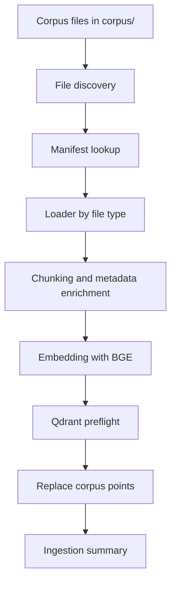
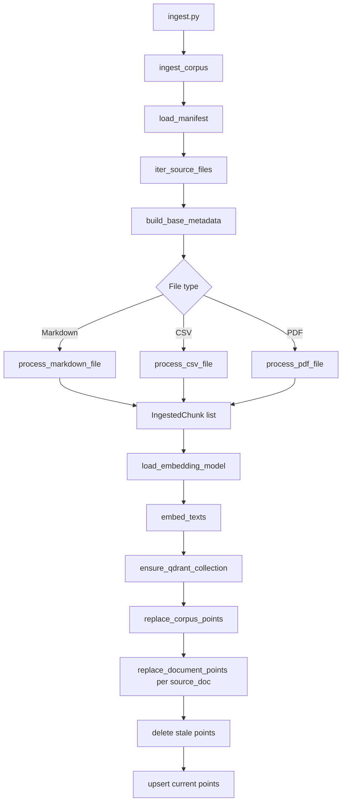

# Ingestion Pipeline Design

This document explains the ingestion pipeline for the NordTech HR onboarding agent: what it ingests, how it chunks and enriches source material, how it embeds and stores chunks in Qdrant, and why the implementation is shaped the way it is.

The goal was not to build a generic document loader. The goal was to build a practical, repeatable ingestion path for a small but realistic HR corpus, with enough structure to support retrieval quality, evaluation, and future file-format expansion.

## Scope

The current ingestion pipeline handles the following source types:

- Markdown documents
- CSV documents
- PDF documents

The primary corpus is stored under `corpus/`. The system documentation for the project lives under `docs/`.

The ingestion pipeline is intentionally separate from the retrieval and agent layers. It is responsible for:

- discovering source files
- loading and validating corpus metadata
- splitting documents into retrievable chunks
- generating embeddings
- writing chunks to Qdrant
- replacing stale source content on re-ingestion

It does not answer questions, score confidence, or decide whether to escalate to HR.

## Pipeline Overview



The main entrypoint is [`ingest.py`](../ingest.py). It performs the end-to-end orchestration:

1. load environment variables
2. discover corpus files
3. build chunks
4. generate embeddings
5. ensure the Qdrant collection exists
6. replace the stored points for the corpus
7. print a short ingestion summary

## Design Goals

The pipeline was designed around a few practical goals:

- Keep the implementation small enough to understand in one pass.
- Make re-ingestion safe and repeatable.
- Keep source-format-specific logic isolated.
- Preserve metadata that helps debugging retrieval later.
- Fail loudly when corpus metadata is incomplete or inconsistent.
- Avoid unnecessary external dependencies in the critical path.

These goals shaped most of the decisions in the current implementation.

## Repository Layout

The ingestion code is split into a small package under `ingestion/`:

- `ingestion/sources.py`
  - corpus discovery
  - top-level corpus loading
- `ingestion/chunking.py`
  - Markdown, CSV, and PDF chunking
  - section path and country inference
- `ingestion/manifest.py`
  - manifest loading
  - base metadata construction
  - validation of required metadata fields and allowed values
- `ingestion/embeddings.py`
  - BGE model loading
  - text embedding
  - query prefix preparation
- `ingestion/qdrant.py`
  - Qdrant point conversion
  - stable point IDs
  - document replacement
  - corpus replacement
- `ingestion/models.py`
  - the `IngestedChunk` data model
- `ingestion/settings.py`
  - shared ingestion constants

The top-level [`ingest.py`](../ingest.py) script is intentionally thin. It is the orchestration layer, not the place where chunking or storage logic lives.

## Source Corpus and Manifest

The source documents live in `corpus/`. Each file must have a matching entry in `corpus/manifest.yaml`.

The manifest is the source of truth for base document metadata such as:

- `source_doc`
- `doc_type`
- `category`
- `country`

Example:

```yaml
employee_handbook_v2.1.md:
  source_doc: employee_handbook
  doc_type: handbook
  category: HR
  country: All
```

### Why a manifest instead of hardcoded metadata

We first considered hardcoding source metadata in Python, but that creates avoidable maintenance debt:

- adding a document requires code changes
- metadata can drift from the file corpus
- renames become fragile
- silent fallback behavior is easy to miss

A manifest is a cleaner shape for this problem because it separates content configuration from code. Adding or updating a document becomes a corpus change, not an application change.

The manifest also gives us a deliberate failure mode. If a file is missing from the manifest, ingestion fails immediately with a clear error instead of silently tagging the document as unknown.

### Validation

`ingestion/manifest.py` validates:

- the manifest file exists
- the manifest is a mapping of filename to metadata
- each entry is a mapping
- required fields are present
- `doc_type` is in the allowed vocabulary
- `category` is in the allowed vocabulary

This catches configuration mistakes early, which is especially important while the corpus is still evolving.

## File Discovery

File discovery is handled in `ingestion/sources.py`.

Only supported file types are considered:

- `.md`
- `.markdown`
- `.pdf`
- `.csv`

The current pipeline explicitly excludes `hr_faq_log.csv` from ingestion.

### Why the FAQ log is excluded

The FAQ log is kept out of the retrievable corpus on purpose. It is treated as held-out material for evaluation, not as primary source knowledge.

This avoids a bad evaluation pattern where the system appears to perform well simply because it indexed the same answer text it is later asked to retrieve.

## Chunking Strategy

Chunking lives in `ingestion/chunking.py`.

The chunking strategy is file-type aware:

- Markdown documents are split by heading structure first, then split further into size-limited subchunks.
- CSV rows are converted into text and chunked row-by-row.
- PDF pages are extracted and chunked page-by-page.

The default chunking settings are in `ingestion/settings.py`:

- `DEFAULT_CHUNK_SIZE = 512`
- `DEFAULT_CHUNK_OVERLAP = 64`

### Why 512 / 64

This is a pragmatic default for HR policy text:

- large enough to preserve useful local context
- small enough to keep chunks focused
- overlap is enough to reduce boundary loss without producing too much redundancy

The exact values are not sacred. They are good starting values for the current corpus size and document style.

### Markdown chunking

Markdown is treated as structured text, not as a flat string.

The pipeline:

1. splits on `#`, `##`, and `###`
2. derives a `section_path`
3. subchunks long sections using a recursive character splitter

Example metadata:

```python
{
    "source_doc": "leave_absence_policy",
    "doc_type": "policy",
    "category": "HR",
    "country": "Estonia",
    "file_type": "markdown",
    "section_path": "Leave Policy > Estonia > Annual Leave",
    "page_number": None,
    "row_number": None,
    "chunk_index": "3.1",
}
```

### Why heading-aware Markdown chunking

We deliberately avoided plain separator-based chunking for Markdown because the structure itself is useful metadata.

Using headings gives us:

- better traceability during debugging
- cleaner section boundaries
- better evidence alignment during retrieval
- a meaningful `section_path` for later analysis

Page numbers do not exist in Markdown, so section paths are a more accurate representation of origin.

### PDF chunking

PDFs are processed page by page using PyMuPDF. Each page is then split into manageable chunks.

For PDFs, the metadata uses `page_number` instead of `section_path`.

This keeps the schema unified while still reflecting the structural difference between formats.

### CSV chunking

The CSV file is treated as structured row data.

Rows are converted into text using the question and answer columns when present:

- `question`
- `ground_truth_answer`

If those columns are not available, the row is rendered as key-value text.

### Why CSV is handled differently

The CSV document is not typical policy prose. It is a structured FAQ log. Row-level chunking preserves the question/answer pairing and avoids mixing multiple FAQ entries into one chunk.

## Unified Metadata Schema

All chunk types are normalized into the same general metadata shape.

Required or common fields include:

- `source_doc`
- `source_file`
- `doc_type`
- `category`
- `country`
- `file_type`
- `section_path`
- `page_number`
- `row_number`
- `chunk_index`

Format-specific fields are populated only when they make sense:

- Markdown uses `section_path`
- PDF uses `page_number`
- CSV uses `row_number`

### Why a unified schema matters

This is one of the most important design decisions in the pipeline.

Downstream code should not need to know whether a chunk came from Markdown, PDF, or CSV. Retrieval, debugging, evaluation, and logging all benefit from a single payload shape.

It also makes future format support easier. Adding another loader later should mean implementing a new chunking path, not rewriting the rest of the pipeline.

## Country Inference

The pipeline infers country from Markdown section headings when possible.

The known markers are:

- Estonia
- Finland
- Portugal

If a section path mentions one of these countries, the chunk metadata is tagged accordingly. Otherwise it falls back to the document-level country value from the manifest.

### Why infer country at chunk level

Document-level metadata is useful, but it is not always specific enough.

For shared documents that contain country-specific subsections, chunk-level country inference allows more accurate retrieval filtering and better evaluation slicing later.

That was especially important because the corpus was intentionally built with country-specific variation.

## Embeddings

Embedding logic lives in `ingestion/embeddings.py`.

The model used for indexing is:

- `BAAI/bge-small-en-v1.5`

### Why this model

This model was chosen because it is a good fit for the current constraints:

- small footprint
- CPU-friendly
- low storage overhead
- good enough quality for a compact HR corpus

It is practical for local or VM-based ingestion without needing GPU infrastructure.

The current implementation uses sentence-transformers to load and encode the text.

### Query-time instruction prefix

BGE models benefit from a query instruction prefix at retrieval time.

The ingestion pipeline does not apply that prefix to documents. It is only used when formatting user queries later during retrieval.

That split matters:

- documents are embedded as-is
- queries are prefixed for retrieval quality

This avoids polluting the document vector space with query-only scaffolding.

## Qdrant Storage

Qdrant integration lives in `ingestion/qdrant.py`.

The main responsibilities are:

- convert chunks into Qdrant points
- generate stable IDs
- upsert points
- delete stale points for a document before replacement
- replace the full corpus safely

### Stable chunk IDs

Chunk IDs are generated deterministically using a UUID namespace derived from metadata such as:

- `source_doc`
- `file_type`
- `section_path`
- `page_number`
- `row_number`
- `chunk_index`

### Why deterministic IDs matter

Re-running ingestion should not create duplicates for the same chunk identity. Deterministic IDs ensure that if a chunk is unchanged, it maps to the same Qdrant point ID.

That makes the ingestion path repeatable and easier to reason about.

### Deleting stale content

Stable IDs solve only part of the problem. If a section is removed from a source document, the old point would still remain in Qdrant unless it is explicitly deleted.

To handle this, the pipeline replaces content per source document:

1. delete all points with the matching `source_doc`
2. insert the new set of chunks for that document

### Why delete by document before upsert

This is the important idempotency choice.

Without a delete step, the collection can drift over time as old sections disappear from source documents but remain retrievable in Qdrant.

The current design prevents that class of stale-data bug.

### Collection preflight

The top-level ingestion script now ensures the Qdrant collection exists before writing points.

If the collection is missing, the script creates it with:

- vector size derived from the embedding dimension
- cosine distance

This avoids a common operational failure where the first ingestion run breaks because the target collection was never created.

## Top-Level Ingestion Script

[`ingest.py`](../ingest.py) is the orchestration script used to run the full pipeline.

Its responsibilities are intentionally narrow:

- parse CLI arguments
- read environment defaults
- load corpus chunks
- embed texts
- ensure the Qdrant collection exists
- replace corpus points
- print a summary

It does not contain loader logic or chunking logic.

### Why keep the script thin

This keeps the execution path easy to follow:

- source handling lives in the package
- orchestration lives in the script
- storage semantics live in the Qdrant helper

That separation makes the code easier to test and easier to change without side effects.

## Ingestion Flow



## Operational Behavior

The current pipeline is designed to behave safely during repeated runs.

### Re-running ingestion

If the same corpus is ingested again:

- unchanged chunks keep the same stable IDs
- removed chunks are deleted because the document is replaced wholesale
- updated chunks overwrite the old content cleanly

### Missing dependencies

Some optional loaders fall back to local implementations if `langchain_text_splitters` is not installed.

That fallback is accompanied by a warning so a missing dependency does not silently change the chunking behavior without notice.

PDF ingestion still requires PyMuPDF.

### Error handling

The implementation prefers explicit failure over silent degradation for configuration issues:

- missing manifest entry
- missing required manifest fields
- invalid metadata values
- missing Qdrant collection

That is deliberate. This pipeline feeds retrieval quality, so wrong data is worse than a loud error.

## Tests

The ingestion layer has focused tests for the important behavior:

- manifest loading
- base metadata construction
- missing manifest entry errors
- missing manifest field errors
- invalid metadata values
- country inference
- stable chunk ID determinism
- FAQ log exclusion from ingestion

### Why these tests matter

They are not just implementation checks. They guard the decisions that make the ingestion path maintainable:

- the manifest is the source of truth
- the metadata vocabulary stays controlled
- country-specific chunking behaves as expected
- the evaluation FAQ stays out of the retrievable corpus
- point identity remains stable across ingestion runs

## Key Design Decisions

### 1. Manifest over hardcoded registry

Chosen because it separates content config from code and fails loudly on missing entries.

### 2. Unified metadata schema

Chosen because downstream code should not care whether content came from Markdown, CSV, or PDF.

### 3. Heading-aware Markdown chunking

Chosen because structural sections are more useful than raw character splitting for policy documents.

### 4. Country inference from section paths

Chosen because chunk-level country tagging improves retrieval filtering and evaluation slicing.

### 5. BGE small embedding model

Chosen because it fits the CPU and storage constraints while remaining strong enough for this corpus size.

### 6. Deterministic point IDs

Chosen because ingestion should be repeatable and should not create duplicate chunks on reruns.

### 7. Replace-by-document in Qdrant

Chosen because it prevents stale chunks from lingering after source edits.

### 8. Auto-create collection on first run

Chosen because operational readiness should not depend on manual Qdrant setup.

### 9. Exclude FAQ log from ingestion

Chosen because it is an evaluation artifact, not source knowledge.

## What Comes Next

The current ingestion pipeline is a solid base, but the natural next refinements are:

- add collection-size compatibility checks before replacement
- add a small ingestion CLI summary file or log artifact
- introduce richer manifest validation if the corpus grows
- support additional document types if the corpus expands
- add metrics for chunk counts and embedding counts per run

Those are improvements, not blockers. The current pipeline already covers the main operational path.

## Summary

The ingestion system is designed to be practical rather than elaborate:

- documents are discovered from `corpus/`
- metadata is validated through a manifest
- chunking respects file structure
- embeddings use a compact BGE model
- Qdrant is preflighted and populated safely
- stale content is removed on re-ingestion

The resulting pipeline is small, explicit, and resilient enough for the current project phase.
